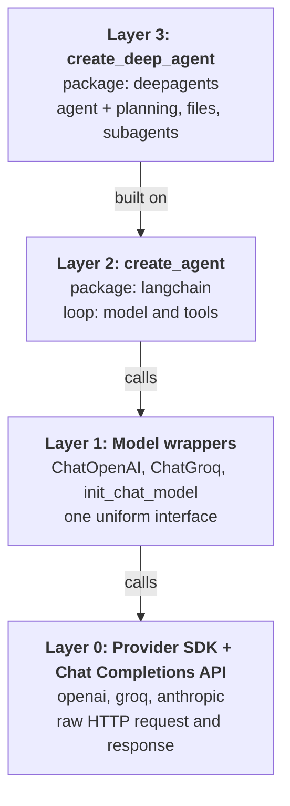
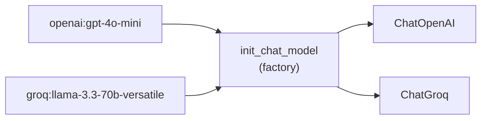
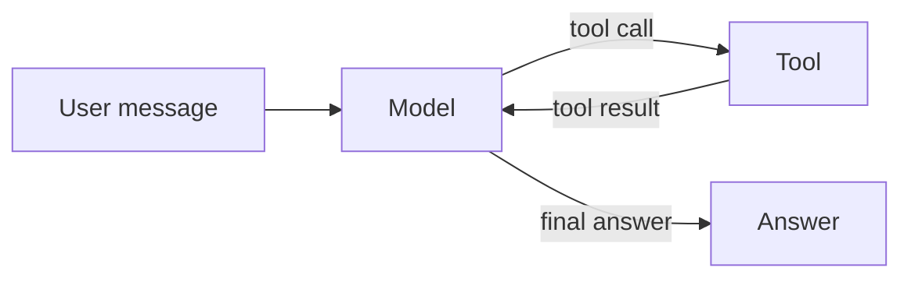

# LangChain Mental Model: From Raw API to Agents

A quick guide to the terms that are easy to mix up:
**Chat Completions API, `ChatOpenAI`, `ChatGroq`, `init_chat_model`, `create_agent`, `create_deep_agent`.**

> **Core idea:** these are 4 layers of one stack. Each layer wraps the one below it.
> The lower layers *talk to a model*. The upper layers *run a loop around a model*.

---

## 1. The stack



Plain-text version (if Mermaid doesn't render):

```
┌──────────────────────────────────────────────────────────┐
│ Layer 3  create_deep_agent   planning, files, subagents  │  <- most opinionated
├──────────────────────────────────────────────────────────┤
│ Layer 2  create_agent        loop: model <-> tools       │
├──────────────────────────────────────────────────────────┤
│ Layer 1  ChatOpenAI / ChatGroq / init_chat_model         │  <- uniform interface
├──────────────────────────────────────────────────────────┤
│ Layer 0  Provider SDK + Chat Completions API             │  <- raw HTTP
└──────────────────────────────────────────────────────────┘
```

---

## 2. Layer by layer

### Layer 0: Chat Completions API (raw wire protocol)

The provider's HTTP endpoint. You send a list of messages and get one reply.
It is **stateless**: you resend the full history on every call. Many providers
(including Groq) copy OpenAI's format, so code often ports across them.

```python
from openai import OpenAI

client = OpenAI()
resp = client.chat.completions.create(
    model="gpt-4o-mini",
    messages=[{"role": "user", "content": "Hi"}],
)
print(resp.choices[0].message.content)
```

You handle JSON, retries, and tool-call parsing yourself.

### Layer 1: LangChain model wrappers

**`ChatOpenAI` / `ChatGroq`** wrap one provider each. They live in separate
packages (`langchain-openai`, `langchain-groq`) but share the same interface:
`.invoke()`, `.stream()`, `.bind_tools()`. They return LangChain message objects.

```python
from langchain_openai import ChatOpenAI
from langchain_groq import ChatGroq

llm = ChatOpenAI(model="gpt-4o-mini")
llm = ChatGroq(model="llama-3.3-70b-versatile")  # swap provider, same usage

llm.invoke("Hi")  # -> AIMessage
```

**`init_chat_model`** is a **factory**. It picks and builds the right wrapper
class from a `"provider:model"` string. It is a shortcut, not a different kind of model.



```python
from langchain.chat_models import init_chat_model

llm = init_chat_model("openai:gpt-4o-mini")             # returns a ChatOpenAI
llm = init_chat_model("groq:llama-3.3-70b-versatile")   # returns a ChatGroq
```

### Layer 2: `create_agent` (adds a loop)

A model answers once. An **agent** loops: the model may call a tool, the tool
runs, the result goes back to the model, and this repeats until a final answer.



```python
from langchain.agents import create_agent

def get_weather(city: str) -> str:
    """Get weather for a city."""
    return f"It's sunny in {city}!"

agent = create_agent(
    model="openai:gpt-4o-mini",   # a string, or a ChatOpenAI / ChatGroq object
    tools=[get_weather],
    system_prompt="You are a helpful assistant.",
)

agent.invoke({"messages": [{"role": "user", "content": "Weather in Pune?"}]})
```

### Layer 3: `create_deep_agent` (adds a full harness)

Comes from a **separate package**, `deepagents`. It is a more opinionated
harness on top of `create_agent`: same building blocks, plus filesystem access,
planning, sub-agents, context management, and skills.

```python
from deepagents import create_deep_agent

agent = create_deep_agent(
    model="anthropic:claude-sonnet-4-6",
    tools=[get_weather],
)
agent.invoke({"messages": [{"role": "user", "content": "Research X and write a report"}]})
```

---

## 3. Which one should I use?

| I want to...                                                        | Use                                   |
|---------------------------------------------------------------------|---------------------------------------|
| See or control exactly what goes over HTTP                          | Chat Completions API (raw SDK)        |
| One prompt in, one answer out, inside LangChain                     | `ChatOpenAI` / `ChatGroq`             |
| Switch providers easily, or pick the model from config / env var    | `init_chat_model`                     |
| Let the LLM call my tools in a loop                                 | `create_agent`                        |
| Long multi-step task (research, coding) with planning and subagents | `create_deep_agent`                   |

### Raw API vs `init_chat_model`

| Situation                                              | Choice                                          |
|--------------------------------------------------------|-------------------------------------------------|
| No LangChain in the project                            | Raw API                                         |
| Need a brand-new provider feature right now            | Raw API (or `ChatOpenAI` with extra params)     |
| Building an agent with `create_agent`                  | `init_chat_model` (or just pass the string)     |
| Want to swap models without rewriting code             | `init_chat_model`                               |
| Locked to one provider, want its specific options      | `ChatOpenAI` / `ChatGroq` directly              |

---

## 4. Does LangChain use the provider's SDK?

Mostly yes. Each provider package is a thin wrapper around the provider's official SDK.

| LangChain class | Package              | SDK underneath |
|-----------------|----------------------|----------------|
| `ChatOpenAI`    | `langchain-openai`   | `openai`       |
| `ChatAnthropic` | `langchain-anthropic`| `anthropic`    |
| `ChatGroq`      | `langchain-groq`     | `groq`         |

What the wrapper does on `llm.invoke("Hi")`:

1. Converts LangChain messages into the provider's request format.
2. Calls the SDK (for example `client.chat.completions.create(...)`).
3. Converts the response back into an `AIMessage`, including tool calls and token usage.

Caveats:

- The wrapper may use a different endpoint than Chat Completions (for example
  OpenAI's Responses API). Check the current docs for the default.
- Some community integrations call the HTTP API directly, or reuse the OpenAI
  SDK with a different base URL.

---

## 5. Two rules that clear up most confusion

1. **Model vs. agent.** Layers 0 and 1 are about *talking to a model* (one call).
   Layers 2 and 3 are about *running a loop around a model*.
2. **Agents accept a model either way.** Both `create_agent` and
   `create_deep_agent` take a string (`"groq:llama-3.3-70b-versatile"`) or a
   model object (`ChatGroq(...)`). A string is resolved through `init_chat_model`.

---

## 6. LangChain Classic vs. current LangChain

- **`langchain` (1.x):** slimmed-down package focused on building agents
  (`create_agent`, middleware, standardized content blocks). Requires Python 3.10+.
- **`langchain-classic`:** legacy package holding old chains, `AgentExecutor`,
  `LLMChain`, the hub module, and other deprecated pieces. It gets fewer fixes.
  Use it only to keep old code running (`from langchain_classic...`), not for new projects.

## 7. Common gotchas

- The raw API is **stateless**. You must resend the conversation history every call.
- Provider wrappers live in **separate packages**. Install `langchain-openai`,
  `langchain-groq`, and so on as needed.
- `create_deep_agent` needs **`pip install deepagents`**. It is not part of `langchain`.
- Keep SDK and LangChain wrapper versions in step. Upgrading one can break the other.