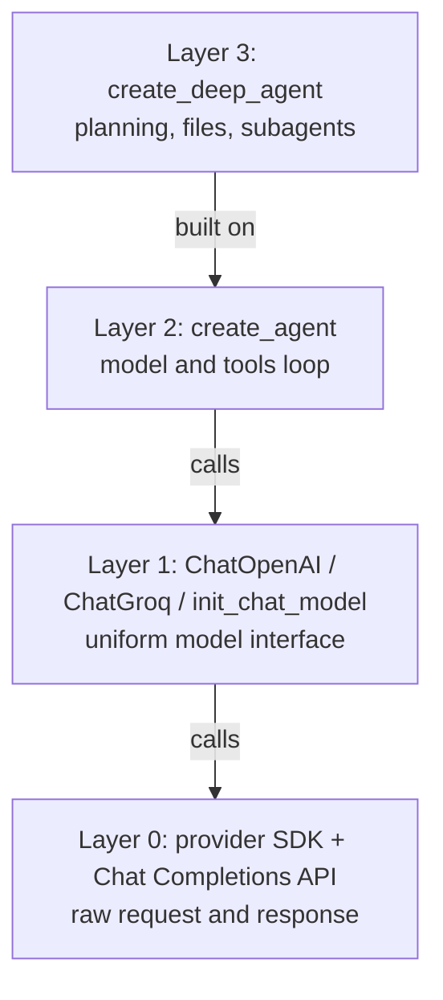

# LangChain Mental Model: Runnable Examples

Small Python scripts that show how the LangChain stack grows from a provider SDK call into an agent harness. Each example focuses on one idea; the source concepts and layer names come from [From Raw API to Agents.md](../From%20Raw%20API%20to%20Agents.md).

## The four layers



Layers 0 and 1 make one model call. Layers 2 and 3 run a model/tool loop; Layer 3 adds a fuller harness.

## Quickstart

Copy `.env.example` to `.env`, then fill in the chosen provider key and model name. From this folder, run:

```console
python -m venv .venv
python -m pip install -r requirements.txt
python examples/02_model_wrappers/01_chat_openai.py
```

The examples require valid credentials for the selected provider. Layer 3 additionally needs the optional `deepagents` package and Python 3.11 or newer.

## Layers and examples

| Layer | What it adds | Examples | Guide |
|---|---|---|---|
| 0 — Raw API | Direct SDK requests; resend full history | [01_raw_api](examples/01_raw_api/README.md) | [Layer 0 notes](docs/00-mental-model.md#layer-0-chat-completions-api) |
| 1 — Model wrappers | A uniform LangChain model interface | [02_model_wrappers](examples/02_model_wrappers/README.md) | [Choosing a layer](docs/02-choosing-the-right-layer.md) |
| 2 — `create_agent` | A model and tool loop | [03_create_agent](examples/03_create_agent/README.md) | [SDK vs. LangChain](docs/03-sdk-vs-langchain.md) |
| 3 — `create_deep_agent` | Planning, filesystem context, and subagents | [04_create_deep_agent](examples/04_create_deep_agent/README.md) | [Setup](docs/01-setup.md) |
| Compare | The same weather task at every layer | [05_same_task_all_layers](examples/05_same_task_all_layers/README.md) | [Choosing a layer](docs/02-choosing-the-right-layer.md) |

## Guides

- [The four-layer mental model](docs/00-mental-model.md)
- [Setup and running examples](docs/01-setup.md)
- [Choosing the right layer](docs/02-choosing-the-right-layer.md)
- [SDK vs. LangChain](docs/03-sdk-vs-langchain.md)
- [Troubleshooting](docs/04-troubleshooting.md)

The examples use the provider's current model name configured in `.env`; model IDs can change or become unavailable. Weather values in shared-tool examples are labeled sample data, not live conditions.
