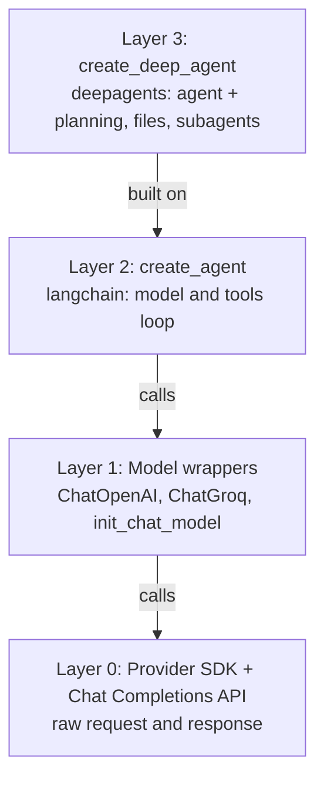
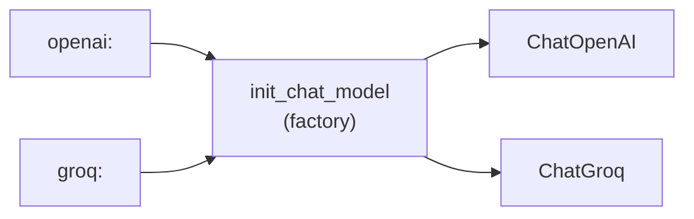
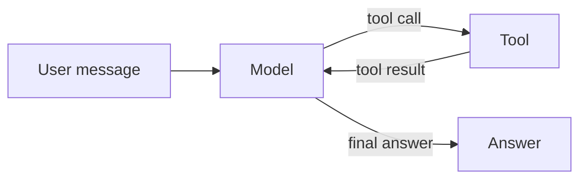

# The four-layer mental model

The stack moves from a provider's raw request format toward increasingly opinionated agent harnesses. The lower layers talk to a model; the upper layers run a loop around a model.



```text
┌──────────────────────────────────────────────────────────┐
│ Layer 3  create_deep_agent   planning, files, subagents  │
├──────────────────────────────────────────────────────────┤
│ Layer 2  create_agent        loop: model <-> tools       │
├──────────────────────────────────────────────────────────┤
│ Layer 1  ChatOpenAI / ChatGroq / init_chat_model         │
├──────────────────────────────────────────────────────────┤
│ Layer 0  Provider SDK + Chat Completions API             │
└──────────────────────────────────────────────────────────┘
```

## Layer 0: Chat Completions API

A provider SDK sends messages to the provider and returns one response. It is stateless: every call must include the history that matters. You control the request and response handling directly.

## Layer 1: Model wrappers

`ChatOpenAI` and `ChatGroq` wrap provider integrations behind a common LangChain interface such as `.invoke()`, `.stream()`, and `.bind_tools()`. `init_chat_model` is a factory that selects a provider wrapper from a `provider:model` identifier.



## Layer 2: `create_agent`

An agent repeatedly asks its model what to do. It may call a tool, pass the tool result back to the model, and continue until it produces a final answer.



`create_agent` is the current LangChain API for this loop; these examples do not use classic chains or legacy agent executors.

## Layer 3: `create_deep_agent`

The separate `deepagents` package builds on the agent loop with a fuller harness, including planning, a virtual filesystem, and subagents. A model still needs to support tool calling.

## Two useful distinctions

1. A model wrapper makes a model call; an agent runs a loop around a model.
2. Both `create_agent` and `create_deep_agent` accept either a `provider:model` string or an initialized chat model object.

## Official documentation

- [LangChain agents](https://docs.langchain.com/oss/python/langchain/agents)
- [LangChain models and `init_chat_model`](https://docs.langchain.com/oss/python/langchain/models)
- [ChatOpenAI](https://docs.langchain.com/oss/python/integrations/chat/openai)
- [ChatGroq](https://docs.langchain.com/oss/python/integrations/chat/groq)
- [Deep Agents overview](https://docs.langchain.com/oss/python/deepagents/overview)
- [Deep Agents quickstart](https://docs.langchain.com/oss/python/deepagents/quickstart)
