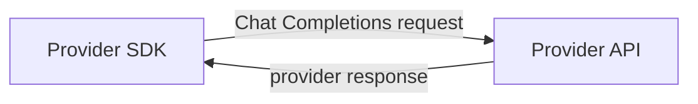

# Layer 0: Raw provider API

These scripts call provider SDKs directly. A request sends messages to a provider and receives a provider-specific response; there is no LangChain wrapper or automatic conversation memory.



**Layer:** 0 — Provider SDK + Chat Completions API.

| File | What it demonstrates | How to run |
|---|---|---|
| `01_openai_chat_completions.py` | One direct OpenAI SDK request | `python examples/01_raw_api/01_openai_chat_completions.py` |
| `02_groq_chat_completions.py` | One direct Groq SDK request | `python examples/01_raw_api/02_groq_chat_completions.py` |
| `03_stateless_history.py` | Resending the full conversation history | `python examples/01_raw_api/03_stateless_history.py` |

## Expected output

Each script prints the provider's generated text. The history example makes two requests and prints a response that uses a fact from the first user message because that earlier message is sent again.

```text
[Provider-generated response; wording varies]
```

## Common mistakes

- Forgetting the corresponding API key or model name in `.env`.
- Expecting the provider to remember a previous request automatically.
- Choosing a model that is not available to the account or does not support the requested operation.
