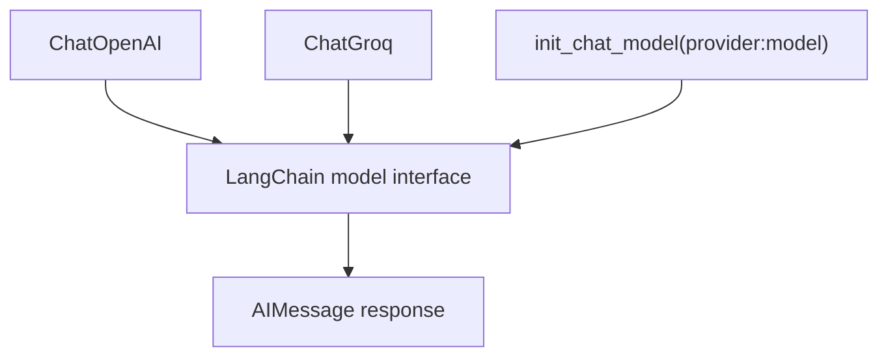

# Layer 1: Model wrappers

LangChain model integrations wrap individual provider SDKs with a common message interface. Use a provider class directly for its integration, or use `init_chat_model` to choose from a `provider:model` string; these are model calls, not agent loops.



**Layer:** 1 — `ChatOpenAI`, `ChatGroq`, and `init_chat_model`.

| File | What it demonstrates | How to run |
|---|---|---|
| `01_chat_openai.py` | Direct OpenAI wrapper invocation | `python examples/02_model_wrappers/01_chat_openai.py` |
| `02_chat_groq.py` | Direct Groq wrapper invocation | `python examples/02_model_wrappers/02_chat_groq.py` |
| `03_init_chat_model.py` | `provider:model` factory usage | `python examples/02_model_wrappers/03_init_chat_model.py` |
| `04_swap_provider_via_env.py` | Selecting OpenAI or Groq from `.env` | `python examples/02_model_wrappers/04_swap_provider_via_env.py` |
| `05_inspect_ai_message.py` | Message content, usage, and tool-call fields | `python examples/02_model_wrappers/05_inspect_ai_message.py` |

## Expected output

Each example prints model-generated content or a compact summary of the returned `AIMessage`. Token usage and tool-call data depend on provider and model support.

```text
[Model-generated response or AIMessage field summary]
```

## Common mistakes

- Installing `langchain` without the separate provider integration package.
- Using a model name from the wrong provider.
- Assuming `bind_tools()` executes the requested tool; it only binds the tool schema to the model.
