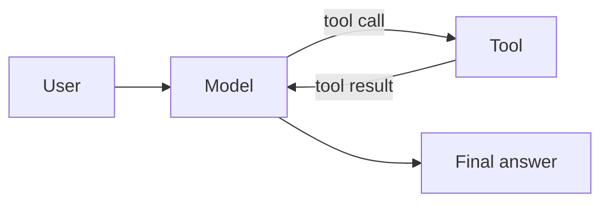

# Layer 2: `create_agent`

`create_agent` adds a loop around a model. The model can ask for a tool, the agent executes it, and the result goes back to the model until it returns a final answer. The minimal example has no tools; the other examples make this loop visible.



**Layer:** 2 — `create_agent` from `langchain`.

| File | What it demonstrates | How to run |
|---|---|---|
| `01_minimal_agent.py` | An agent without custom tools | `python examples/03_create_agent/01_minimal_agent.py` |
| `02_agent_with_tools.py` | Calling a deterministic sample tool | `python examples/03_create_agent/02_agent_with_tools.py` |
| `03_string_vs_model_object.py` | Model identifier string vs. initialized object | `python examples/03_create_agent/03_string_vs_model_object.py` |
| `04_stream_agent_steps.py` | State updates for model and tool steps | `python examples/03_create_agent/04_stream_agent_steps.py` |

## Expected output

The minimal example prints a final model response. Tool examples print a response based on the sample tool data; streaming prints progress updates and tool activity. Exact wording is model-dependent.

```text
Step: model
Requested tools: [tool-call details]
Step: tools
Tool result: [sample weather data]
Step: model
Final answer: [model-generated response]
```

## Common mistakes

- Expecting a tool to run when the prompt does not clearly ask for information it provides.
- Selecting a model without tool-calling support.
- Treating a provider/model string as a model name alone; the format includes the provider.
