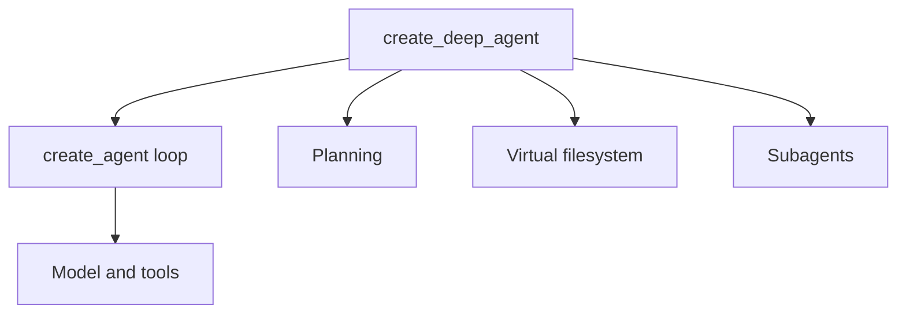

# Layer 3: `create_deep_agent`

`create_deep_agent` comes from the separate `deepagents` package. It builds on the model/tool loop with a fuller harness, including planning and virtual filesystem tools. Use it when a task benefits from these capabilities; a short single-call task usually does not need it.



**Layer:** 3 — `create_deep_agent` from `deepagents` (separate install).

| File | What it demonstrates | How to run |
|---|---|---|
| `01_hello_deep_agent.py` | A minimal deep agent | `python examples/04_create_deep_agent/01_hello_deep_agent.py` |
| `02_deep_agent_with_tools.py` | A custom tool in the deep-agent harness | `python examples/04_create_deep_agent/02_deep_agent_with_tools.py` |
| `03_planning_and_files.py` | Built-in planning and virtual file tools | `python examples/04_create_deep_agent/03_planning_and_files.py` |

## Expected output

The first two examples print a final response. The last asks the agent to make a short plan and create a virtual file, then prints the conversation so the planned file action is visible. The virtual filesystem is not automatically a file on your computer.

```text
Built-in tool: [planning or virtual file tool]
Final response: [model-generated response]
```

## Common mistakes

- Forgetting to install `deepagents` separately.
- Running the current Deep Agents package on Python 3.10; it requires Python 3.11 or newer.
- Expecting virtual filesystem paths to refer to local files.
