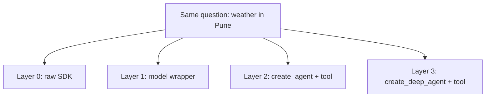

# The same task at all four layers

These scripts compare one question—“What's the weather in Pune?”—at each layer. Lower layers make one direct model call with clearly labeled sample context; agent layers can call the deterministic sample-weather tool. None of the examples retrieves live weather.



**Layers:** 0 through 3.

| File | What it demonstrates | How to run |
|---|---|---|
| `layer0_raw.py` | Raw SDK request with sample context | `python examples/05_same_task_all_layers/layer0_raw.py` |
| `layer1_wrapper.py` | One LangChain wrapper call with sample context | `python examples/05_same_task_all_layers/layer1_wrapper.py` |
| `layer2_agent.py` | `create_agent` calling the weather tool | `python examples/05_same_task_all_layers/layer2_agent.py` |
| `layer3_deep_agent.py` | `create_deep_agent` with the same tool | `python examples/05_same_task_all_layers/layer3_deep_agent.py` |

## Expected output

Each script prints an answer about the same Pune weather sample. The direct calls are given the sample in their request; the agents should call the tool. Response wording is generated and may vary.

```text
[Answer based on the Pune sample weather data]
```

## Common mistakes

- Assuming the example reports current weather; the tool returns fixed sample data.
- Comparing response wording instead of how each layer handles the request.
- Running the Layer 3 version without Python 3.11+ and the optional `deepagents` package.
